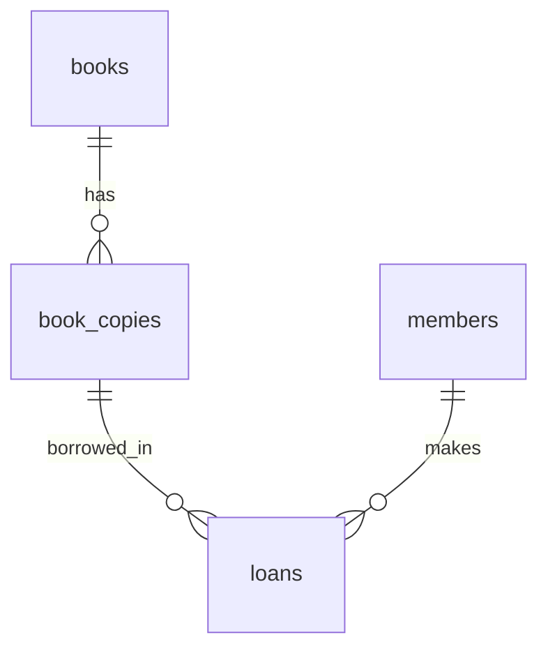

# Library Database Lab

Dự án dành cho người mới học **SQLite + Python + pandas + Seaborn + Matplotlib + Jupyter**. Bạn sẽ thiết kế bảng, thực hiện quy trình mượn/trả, viết SQL và tạo báo cáo. Dữ liệu mẫu là **GIẢ LẬP**, không phải thông tin độc giả thực.

## Bắt đầu trên Windows

Yêu cầu Python **3.12**, Git nếu muốn clone, VS Code là tùy chọn. Mở PowerShell tại thư mục dự án. Lệnh pip cài các thư viện; SQLite đã có trong Python.

```powershell
git clone https://github.com/domixilaphungthodanh/library-database-lab.git
cd library-database-lab
python -m venv .venv
.venv\Scripts\python.exe -m pip install -r requirements.txt
.venv\Scripts\python.exe -m library_lab.init_db --sample
.venv\Scripts\python.exe -m library_lab.cli
```

Không cần kích hoạt môi trường: gọi trực tiếp `.venv\Scripts\python.exe` như trên. Trên macOS/Linux, thay bằng `.venv/bin/python`.

Nếu môi trường đã kích hoạt, các lệnh chuẩn là:

```bash
python -m pip install -r requirements.txt
python -m library_lab.init_db --sample
python -m library_lab.cli
python -m library_lab.analyze
python -m jupyter notebook
```

Lần khởi tạo đầu tạo `database/library.db`. Lệnh khởi tạo **từ chối nếu file đã tồn tại**, kể cả file rỗng; không xóa hay ghi đè database. Muốn bài học mới, dùng đường dẫn khác và truyền cùng `--db` cho các lệnh sau:

```bash
python -m library_lab.init_db --sample --db database/practice2.db
python -m library_lab.cli --db database/practice2.db
python -m library_lab.analyze --db database/practice2.db --output outputs/practice2 --as-of 2025-12-31
```

Không có `--sample` sẽ tạo database rỗng để tự nhập dữ liệu.

## Thử quy trình đầu tiên

Với database mẫu, bản sao `copy_id=21` đang còn sẵn và độc giả `member_id=1` đã có:

1. Chọn **9**: xem các bản sao còn sẵn.
2. Chọn **6**: nhập mã bản sao `21`, mã độc giả `1`, Enter để dùng ngày hôm nay. Ghi lại mã lượt mượn được in ra.
3. Chọn **8**: kiểm tra lượt vừa mượn.
4. Chọn **7**: nhập mã lượt vừa tạo, Enter để trả hôm nay.
5. Chọn **9**: bản sao 21 lại còn sẵn. Chọn **0** để thoát.

Thêm đầu sách bằng mục 1, thêm từng cuốn vật lý bằng mục 2, đăng ký độc giả bằng mục 4. `book_id`, `copy_id`, `member_id`, `loan_id` là các mã khác nhau; mượn sách dùng **copy_id**, trả sách dùng **loan_id**.

## Dữ liệu và quy tắc

- Mẫu: 20 đầu sách, 40 bản sao, 30 độc giả, 150 lượt mượn; seed 42.
- Có 130 lượt đã trả và 20 lượt đang mượn. Tại **2025-12-31**, có 10 lượt đang quá hạn và 10 lượt chưa quá hạn.
- Ngày mặc định của ứng dụng là ngày thực tế UTC+7. Để tái hiện bài học mẫu, dùng `--as-of 2025-12-31` khi xem hoặc phân tích quá hạn.
- `--as-of` chỉ đổi ngày đánh giá quá hạn trên trạng thái hiện có; không tái dựng lịch sử trạng thái.
- Hạn trả = ngày mượn + 14 ngày. Quá hạn khi **chưa trả và ngày tham chiếu > hạn trả**. Đến ngày hạn trả vẫn đúng hạn.
- Không lưu trạng thái còn sẵn: suy ra từ việc bản sao có lượt chưa trả hay không.
- Một bản sao chỉ có một lượt chưa trả. Database còn ngăn lịch sử mượn chồng nhau. Do chỉ lưu ngày, lượt tiếp theo được phép từ **ngày sau ngày trả**; không mượn lại cùng ngày.
- Ngày mượn/trả phải hợp lệ `YYYY-MM-DD`, không ở tương lai; ngày trả không trước ngày mượn. Cho phép trả ngay ngày mượn.
- Tên sách, tác giả, danh mục, mã cuốn và tên độc giả không được rỗng. Email tùy chọn; nếu nhập được trim, chuyển chữ thường và phải duy nhất. Chưa kiểm tra đầy đủ định dạng email.
- Tìm kiếm dùng tham số SQL, `%` và `_` được coi là ký tự thường. SQLite LIKE mặc định không hỗ trợ đầy đủ chuyển hoa/thường Unicode; từ khóa tiếng Việt nên giữ đúng dấu và chữ hoa/thường.
- Bật khóa ngoại trên mọi kết nối. Mượn/trả dùng transaction để thành công toàn bộ hoặc rollback. Không có chức năng xóa dữ liệu lịch sử.

## Sơ đồ quan hệ



Một đầu sách có nhiều bản sao; một bản sao có nhiều lượt mượn theo thời gian; một độc giả có nhiều lượt mượn. Xem [từ điển dữ liệu](docs/data_dictionary.md).

## Học qua notebook và báo cáo

```bash
python -m jupyter notebook
```

Mở `notebooks/01_library_analysis.ipynb`, chọn kernel của `.venv`, chạy từ trên xuống. Notebook tự tạo database mẫu nếu chưa có file mặc định, không thay database có sẵn. Ô đầu có `DB` và `AS_OF` để chọn dữ liệu/ngày tham chiếu.

Xuất kết quả mẫu:

```bash
python -m library_lab.analyze --as-of 2025-12-31
```

Kết quả trong `outputs/`: 4 ảnh PNG, 5 bảng CSV và `report.md`. Biểu đồ gồm top đầu sách, lượt mượn theo tháng, theo danh mục và phân phối thời gian mượn của lượt đã trả. Nếu chưa có dữ liệu, ảnh ghi rõ chưa có dữ liệu.

Báo cáo luôn chứa giới hạn dữ liệu. Nếu bạn nhập dữ liệu thật, cập nhật phần mô tả nguồn trước khi chia sẻ. Số lượt mượn không phải số độc giả duy nhất; thời gian của lượt đã trả có thể bỏ sót những lượt đang kéo dài.

## Lộ trình 3 tuần

| Tuần | Nội dung | Đầu ra |
|---|---|---|
| 1 | Bảng, khóa chính/ngoại, SELECT, WHERE, JOIN, GROUP BY | Hiểu schema, hoàn thành bài tập SQL cơ bản |
| 2 | Python, CRUD, kiểm tra dữ liệu, transaction | Tự chạy quy trình thêm sách → mượn → trả |
| 3 | pandas, Seaborn, notebook, viết nhận xét | 4 biểu đồ, báo cáo và bài tập nâng cao |

Làm [bài tập](docs/exercises.md) trước khi đọc [lời giải](docs/solutions.md). Ví dụ SQL chạy được nằm trong `sql/analysis.sql`.

## Cấu trúc và nhiệm vụ

```text
library_lab/db.py         Kết nối SQLite, đường dẫn, kiểm tra ngày
library_lab/service.py    Quy tắc thêm sách/độc giả và mượn/trả
library_lab/init_db.py    Tạo database mới và dữ liệu mẫu
library_lab/cli.py        Menu terminal
library_lab/analyze.py    Đọc SQLite, xuất bảng, biểu đồ và báo cáo
sql/schema.sql           Bảng, khóa, index và trigger
sql/analysis.sql         Truy vấn học SQL
notebooks/               Hướng dẫn phân tích từng bước
docs/                    Từ điển dữ liệu, bài tập và lời giải
tests/                   Kiểm thử bằng unittest
.github/workflows/       Kiểm tra tự động trên GitHub
requirements.txt         Thư viện cần cài
.gitignore               Bỏ qua môi trường, database và kết quả sinh ra
```

## Kiểm thử và GitHub Actions

```bash
python -m unittest discover -s tests -v
```

Kiểm thử dùng database tạm, không sửa dữ liệu của bạn. Workflow **Verify library lab** chạy khi push/pull request: cài Python 3.12, chạy unittest, tạo mẫu, phân tích và chạy notebook. Mở tab **Actions**, chọn lần chạy, xem log và tải artifact **library-analysis** gồm ảnh, CSV, báo cáo và notebook đã chạy. Artifact giữ 14 ngày; workflow không commit kết quả vào repo.

Phiên bản này dành cho một người thực hành trên máy. Chưa có đăng nhập, đặt trước, tiền phạt, xóa sách hay giao diện web.
